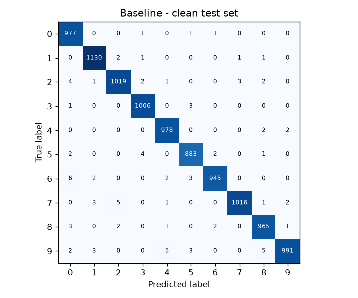
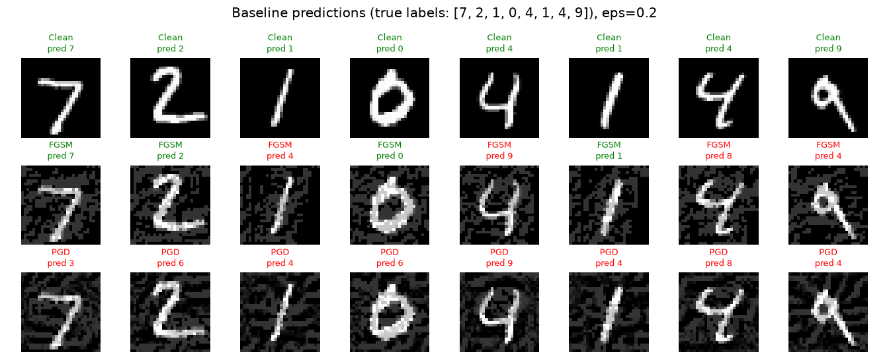
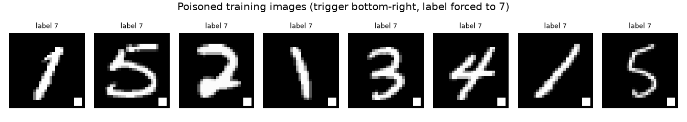
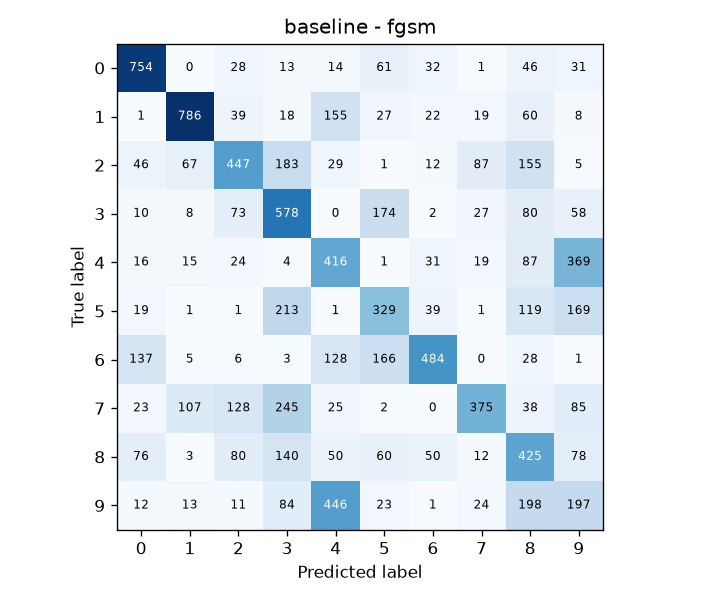
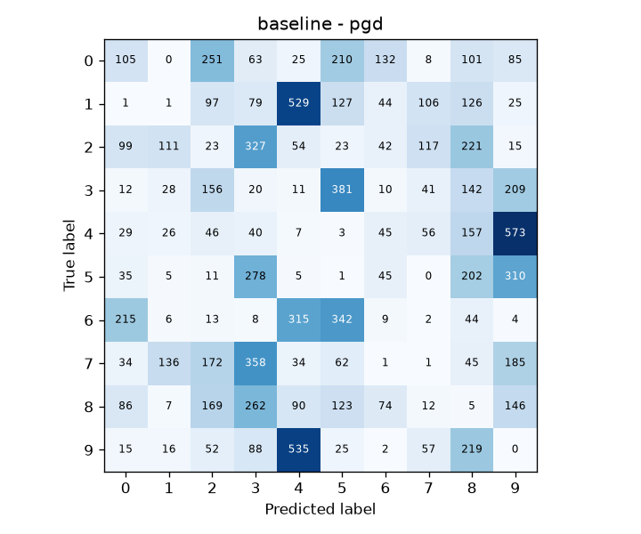
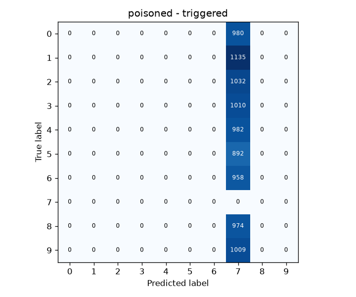
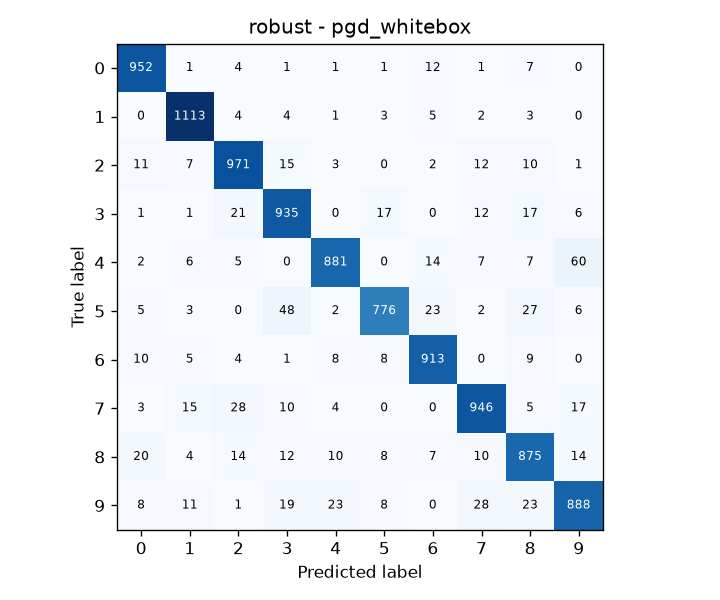

# Secure AI Systems: Red and Blue Teaming an MNIST Classifier

**Author:** Devanarayan S R, CS26MTECH12005
**Repository (CNN implementation, attacks, and dataset generation):** https://github.com/srdevanarayan/SSE_Assignment

This project builds a small PyTorch CNN that classifies handwritten digits (MNIST), threat-models it, scans the code for security issues, attacks it (red team), and defends it (blue team).

**Results at a glance**

|                                                         | Clean accuracy | Accuracy under PGD white-box attack (ε = 0.2) |
| ------------------------------------------------------- | -------------- | --------------------------------------------- |
| Baseline (no defense)                                   | 99.10%         | 1.66%                                         |
| Best defense (adversarial training + feature squeezing) | 98.42%         | 96.97%                                        |

| Backdoor poisoning (5% of training data) | Result                                                     |
| ---------------------------------------- | ---------------------------------------------------------- |
| Poisoned model, clean accuracy           | 99.12% (looks normal)                                      |
| Poisoned model, attack success rate      | 100.00%                                                    |
| Integrity check                          | Poisoned data blocked, 3000 of 3000 poisoned samples found |

---

## Contents

1. [How to run](#1-how-to-run)
2. [Project structure](#2-project-structure)
3. [Dataset and train/test split](#3-dataset-and-traintest-split)
4. [Model and training](#4-model-and-training)
5. [Baseline performance](#5-baseline-performance)
6. [Threat model](#6-threat-model)
7. [SAST findings and fixes](#7-sast-findings-and-fixes)
8. [Red teaming](#8-red-teaming)
9. [Performance under attack](#9-performance-under-attack)
10. [Blue teaming](#10-blue-teaming)
11. [Conclusions and observations](#11-conclusions-and-observations)
12. [Use of AI tools](#12-use-of-ai-tools)

---

## 1. How to run

### 1.1 Requirements

- Python 3.11 or newer (Pillow 13, needed for the security fixes in section 7, does not support Python 3.10)
- About 1 GB of free disk space (PyTorch, MNIST, saved datasets)
- A CPU is enough, an NVIDIA GPU is used automatically if available

### 1.2 Setup (once)

```bash
# 1. Get the code
git clone https://github.com/srdevanarayan/SSE_Assignment.git
cd SSE_Assignment

# 2. Create and activate a virtual environment (Python 3.11 or newer)
python3.11 -m venv .venv
source .venv/bin/activate          # Linux / macOS

# 3. Install the dependencies
pip install -r requirements.txt
```

MNIST (about 12 MB) downloads automatically into `data/` the first time a script needs it.

### 1.3 Run everything with one command

```bash
bash run_all.sh                                        # Linux / macOS / Git Bash
```

When it finishes, open `results/summary.md` for all the result tables.

### 1.4 Run step by step

Run these from the project folder, in this order.

| #   | Command                                           | What it does                                                                     | Time      | Creates                                                                                         |
| --- | ------------------------------------------------- | -------------------------------------------------------------------------------- | --------- | ----------------------------------------------------------------------------------------------- |
| 1   | `python step1_train_baseline.py`                  | Trains the baseline CNN on clean data                                            | 2-5 min   | `models/baseline.pt`                                                                            |
| 2   | `python step2_evaluate_baseline.py`               | Measures accuracy, loss, precision, recall, F1, confusion matrix, inference time | < 1 min   | `results/baseline_clean.json`, confusion matrix PNG                                             |
| 3   | (nothing to run)                                  | Threat model, written in [section 6](#6-threat-model)                            | -         | -                                                                                               |
| 4   | `bash step4_run_sast.sh`                          | Bandit SAST scan + pip-audit dependency check                                    | < 1 min   | `results/sast/*`                                                                                |
| 5a  | `python step5a_red_team_adversarial.py`           | Attack 1: builds FGSM and PGD adversarial test sets                              | 2-5 min   | `data/adversarial/*.pt`, `results/adversarial_examples.png`                                     |
| 5b  | `python step5b_red_team_poisoning.py`             | Attack 2: poisons 5% of training data, trains a poisoned model                   | 2-5 min   | `data/poisoned/train_poisoned.pt`, `models/poisoned.pt`, `results/poisoned_examples.png`        |
| 6   | `python step6_evaluate_attacks.py`                | Re-tests the models on the attacked data                                         | < 1 min   | `results/baseline_fgsm.json`, `baseline_pgd.json`, `poisoned_*.json`, `baseline_triggered.json` |
| 7a  | `python step7a_blue_team_adversarial_training.py` | Defense 1: adversarial training on clean + adversarial data                      | 15-40 min | `models/robust_adv_trained.pt`                                                                  |
| 7b  | `python step7b_blue_team_data_integrity.py`       | Defense 3: SHA-256 integrity check of training data                              | < 1 min   | `data/trusted_manifest.json`, `results/integrity_check.json`                                    |
| 8   | `python step8_evaluate_defenses.py`               | Tests all defenses (including feature squeezing, defense 2) against the baseline | 5-20 min  | `results/defense_comparison.json`, confusion matrix PNGs                                        |
| 9   | `python step9_make_summary.py`                    | Collects every result into one file                                              | seconds   | `results/summary.md`                                                                            |

### 1.5 Changing the experiment

All settings live in `config.py` (for example `EPSILON`, `POISON_RATE`, `TARGET_LABEL`, `EPOCHS`). After changing one, re-run from the first step that uses it, then re-run step 9.

---

## 2. Project structure

| File                                       | Assignment task | What it does                                                             |
| ------------------------------------------ | --------------- | ------------------------------------------------------------------------ |
| `config.py`                                | all             | Every setting in one place                                               |
| `model.py`                                 | 1               | The CNN architecture                                                     |
| `common.py`                                | all             | Shared helpers: data loading, training loop, metrics, saving and loading |
| `attacks.py`                               | 5               | FGSM, PGD and backdoor-trigger functions                                 |
| `defenses.py`                              | 7               | Feature squeezing (input binarization) wrapper                           |
| `step1_train_baseline.py`                  | 1               | Trains the baseline CNN                                                  |
| `step2_evaluate_baseline.py`               | 2               | Baseline performance metrics                                             |
| `step4_run_sast.sh`                        | 4               | Bandit (SAST) + pip-audit (dependency check)                             |
| `sast_examples/insecure_example.py`        | 4               | Intentionally insecure code that shows what Bandit catches.              |
| `step5a_red_team_adversarial.py`           | 5               | Attack 1: FGSM + PGD adversarial examples (OWASP ML01)                   |
| `step5b_red_team_poisoning.py`             | 5               | Attack 2: backdoor data poisoning (OWASP ML02)                           |
| `step6_evaluate_attacks.py`                | 6               | Re-tests the models on the attacked data                                 |
| `step7a_blue_team_adversarial_training.py` | 7               | Defense 1: adversarial training                                          |
| `step7b_blue_team_data_integrity.py`       | 7               | Defense 3: training-data integrity check                                 |
| `step8_evaluate_defenses.py`               | 7               | Compares all defenses with the baseline                                  |
| `step9_make_summary.py`                    | report          | Writes `results/summary.md`                                              |
| `run_all.sh`                               | all             | Runs everything in order                                                 |
| `requirements.txt`                         | all             | Python dependencies                                                      |

The `data/` and `models/` folders are excluded from Git (`.gitignore`) because they are large and fully reproducible. The `results/` folder is committed so the figures below display on GitHub.

---

## 3. Dataset and train/test split

MNIST contains 70,000 grayscale images of handwritten digits 0-9, each 28 × 28 pixels.

- **Training set:** 60,000 images (`train=True`, file `train-images-idx3-ubyte`)
- **Test set:** 10,000 images (`train=False`, file `t10k-images-idx3-ubyte`)

We use the official split. The two sets come from different groups of writers, so they do not overlap. torchvision verifies the MD5 checksum of the downloaded files. Pixels are scaled to [0, 1] with `ToTensor()`, without mean/std normalization, so attacks and defenses work directly in pixel space.

**How the split is kept clean across the pipeline:**

- Test images are never used for training. This includes adversarial training (step 7a), which generates attacks from training images only.
- Adversarial test sets (step 5a) and triggered test images (step 6) are built from test images only.
- Poisoning (step 5b) and the integrity check (step 7b) touch training data only.
- All settings were fixed in `config.py` before testing and were not tuned on test results, so no separate validation set was used.

---

## 4. Model and training

**Architecture** (`model.py`), 421,642 trainable parameters:

| Layer         | Details                      | Output shape |
| ------------- | ---------------------------- | ------------ |
| Input         | Grayscale image              | 1 × 28 × 28  |
| Conv2d + ReLU | 32 filters, 3 × 3, padding 1 | 32 × 28 × 28 |
| MaxPool2d     | 2 × 2                        | 32 × 14 × 14 |
| Conv2d + ReLU | 64 filters, 3 × 3, padding 1 | 64 × 14 × 14 |
| MaxPool2d     | 2 × 2                        | 64 × 7 × 7   |
| Flatten       |                              | 3136         |
| Linear + ReLU | 3136 → 128                   | 128          |
| Dropout       | p = 0.25                     | 128          |
| Linear        | 128 → 10 (logits)            | 10           |

**Training setup** (`step1_train_baseline.py`, `config.py`):

| Setting        | Value                                             |
| -------------- | ------------------------------------------------- |
| Loss           | Cross-entropy                                     |
| Optimizer      | Adam, learning rate 0.001                         |
| Batch size     | 64                                                |
| Epochs         | 5                                                 |
| Random seed    | 42 (repeatable runs)                              |
| Saved artifact | `models/baseline.pt` (weights only, `state_dict`) |

---

## 5. Baseline performance

The baseline classifies 99.10% of the 10,000 clean test images correctly.

| Metric                                | Value               |
| ------------------------------------- | ------------------- |
| Accuracy                              | 99.10%              |
| Cross-entropy loss                    | 0.0269              |
| Precision (macro average)             | 0.9910              |
| Recall (macro average)                | 0.9909              |
| F1 score (macro average)              | 0.9909              |
| Inference time, batched (batch of 64) | 0.0997 ms per image |
| Inference time, single image          | 0.256 ms            |



**How the metrics are computed.**

- **Accuracy** is the share of correct predictions.
- **Loss** is the average cross-entropy, which also penalizes correct but unconfident answers.
- **Precision, recall and F1** are computed per digit and averaged equally over the 10 classes (macro average).
- **The confusion matrix** shows, for each true digit (row), how often each digit was predicted (column). The diagonal holds the correct predictions.
- **Batched inference time** is the total forward-pass time divided by 10,000.
- **Single-image latency** is the average of 200 one-image forward passes, which is closer to a real app serving one request at a time. It is higher than the batched figure because batching shares the fixed overhead of each forward pass across 64 images.

---

## 6. Threat model

The two highest risks for this system are manipulated inputs (OWASP ML01) and tampered training data (OWASP ML02), so those are the two attacks tested in sections 8-10. The model covers the system as built and a realistic deployed version where users upload digit images to a prediction API.

### 6.1 System and data flow

1. **Data source:** MNIST downloaded from a public mirror over the network. _Trust boundary 1._
2. **Data storage:** raw files and derived datasets in `data/`.
3. **Training pipeline:** training scripts read data and write model weights.
4. **Model storage:** `models/*.pt` weight files. _Trust boundary 2_ when models are shared or downloaded.
5. **Inference:** the model loads weights and classifies an image. In a deployed version, images arrive from users through an API. _Trust boundary 3._
6. **Output:** the predicted digit returned to the user or a downstream system.

**Assets:** training-data integrity, model weights (integrity and confidentiality), correctness of predictions, availability of the inference service, source code and dependencies, and, in a real deployment, user-submitted images.

### 6.2 Attacker model

| Attacker                            | Goal                                                                 | Knowledge                                                                                                        | Capability                                                                                                                                                                    | Limits                                                             |
| ----------------------------------- | -------------------------------------------------------------------- | ---------------------------------------------------------------------------------------------------------------- | ----------------------------------------------------------------------------------------------------------------------------------------------------------------------------- | ------------------------------------------------------------------ |
| A1: Evasion attacker (OWASP ML01)   | Make the model misclassify inputs at test time (untargeted)          | White-box: knows the architecture and weights. This is the worst case, assuming the model can leak or be copied. | Changes each pixel by at most ε = 0.2 (L∞ norm), keeping pixels in [0, 1]                                                                                                     | No access to training data, training code, or stored weights       |
| A2: Poisoning attacker (OWASP ML02) | Plant a hidden backdoor so images with a trigger are classified as 7 | Knows the task and data format, not the model                                                                    | Modifies 5% of training samples (image and label) before training, e.g. through a compromised mirror or a malicious data contributor; adds the trigger to inputs at test time | Cannot change the training code, the model, or the clean test data |

Out of scope: insiders with code or server access, physical attacks, and operating-system attacks.

### 6.3 STRIDE (ML interpretation)

| STRIDE                 | ML-specific threat in this system                                                                                                                 | OWASP ML               | Controls                                                                                             |
| ---------------------- | ------------------------------------------------------------------------------------------------------------------------------------------------- | ---------------------- | ---------------------------------------------------------------------------------------------------- |
| Spoofing               | A fake data mirror or model file posing as the trusted one; an unauthenticated client calling the prediction API                                  | ML06, ML02             | HTTPS, checksums, signed artifacts, API authentication                                               |
| Tampering              | Adversarial inputs (A1); poisoned or relabeled training data (A2); edited model weights; altered predictions in transit                           | ML01, ML02, ML10, ML09 | Adversarial training, feature squeezing, data integrity manifest, weight hashing, TLS                |
| Repudiation            | No record of who changed a dataset or model, so a poisoning cannot be traced or proven                                                            | ML02, ML10             | Version control for code, data and models; signed commits; audit logs                                |
| Information disclosure | Model inversion reconstructs training images; membership inference reveals whether a sample was used; many queries copy the model                 | ML03, ML04, ML05       | Return only the label (no confidence scores), rate limiting, differential privacy for sensitive data |
| Denial of service      | Flooding the API; very large or malformed uploads; poisoning that lowers accuracy until the service is useless                                    | ML02, ML08             | Rate limiting, input size and type validation, accuracy monitoring                                   |
| Elevation of privilege | A malicious pickle in a `.pt` file runs code when loaded with `torch.load`; a backdoor trigger hands the attacker control of the model's decision | ML06, ML02, ML10       | `weights_only=True`, only `state_dict` saved, trusted model sources, data integrity checks           |

### 6.4 OWASP ML Top 10 mapping

| OWASP ML risk                 | Applies here?          | How                                                                                                                     |
| ----------------------------- | ---------------------- | ----------------------------------------------------------------------------------------------------------------------- |
| ML01 Input Manipulation       | Yes, tested            | FGSM and PGD adversarial examples ([section 8.1](#81-attack-1-adversarial-examples-owasp-ml01-input-manipulation))      |
| ML02 Data Poisoning           | Yes, tested            | Backdoor trigger in 5% of training data ([section 8.2](#82-attack-2-backdoor-data-poisoning-owasp-ml02-data-poisoning)) |
| ML03 Model Inversion          | Partly                 | Possible when confidence scores are exposed; low impact for public MNIST, high for private handwriting                  |
| ML04 Membership Inference     | Partly                 | As ML03; matters if the training data is private                                                                        |
| ML05 Model Theft              | Yes                    | Theft of the weights file, or extraction through many API queries                                                       |
| ML06 AI Supply Chain          | Yes                    | Dataset mirrors, PyPI packages, pickled model files; checked with Bandit and pip-audit                                  |
| ML07 Transfer Learning Attack | No                     | The model is trained from scratch, with no pre-trained weights                                                          |
| ML08 Model Skewing            | Low                    | Only if the model were retrained on user feedback                                                                       |
| ML09 Output Integrity         | Yes (deployed version) | Predictions altered between the model and their consumer                                                                |
| ML10 Model Poisoning          | Yes                    | Direct editing of the weights in `models/`                                                                              |

### 6.5 LINDDUN privacy threats (real-world version)

MNIST itself is public, so these threats apply to a deployed version, for example reading handwritten digits on cheques, forms or postal codes. There, images can carry personal data such as account numbers, signatures, and a person's handwriting style.

| LINDDUN         | Threat in a real deployment                                                                            | Mitigation                                                   |
| --------------- | ------------------------------------------------------------------------------------------------------ | ------------------------------------------------------------ |
| Linking         | Uploads from the same person can be linked by handwriting style, IP address or device                  | Do not store raw uploads; keep logs separate from images     |
| Identifying     | Handwriting can identify a writer; cropped digits may come from forms that include names               | Crop to the digit only; delete images after prediction       |
| Non-repudiation | Logs tying each upload to a user prove they submitted it, which users may not want                     | Minimize and pseudonymize logs; set retention limits         |
| Detecting       | Membership inference reveals whether a person's samples were in the training data                      | Label-only output; differential privacy during training      |
| Data disclosure | Stored images, or a model inversion attack, leak personal data                                         | Encryption at rest, access control, no confidence scores     |
| Unawareness     | Users are not told that uploads may be kept or used for retraining                                     | Clear notice and opt-in for training use                     |
| Non-compliance  | Processing personal data without a lawful basis or retention policy (e.g. GDPR, India's DPDP Act 2023) | Data protection impact assessment, consent, retention policy |

---

## 7. SAST findings and fixes

Bandit found no issues in the final project code. The 8 issues it found in a naive version of the loading and data-handling code are all fixed in the project.

**Tools**

- **Bandit** (from the OWASP list of source code analysis tools) scans Python source for insecure patterns.
- **pip-audit** checks installed packages against known-vulnerability databases (PyPI advisories, OSV). It is an additional software-composition check covering OWASP ML06 (supply chain).

**Method.** `step4_run_sast.sh` scans every project `.py` file. It then separately scans `sast_examples/insecure_example.py`, which holds the naive patterns common in ML tutorials and is kept only for comparison. Reports are saved in `results/sast/`.

**Findings in the naive version and how the project fixes them**

| Bandit ID | Severity | Finding                                    | Risk                                                           | Fix in the project                                                              |
| --------- | -------- | ------------------------------------------ | -------------------------------------------------------------- | ------------------------------------------------------------------------------- |
| B602      | High     | `subprocess` call with `shell=True`        | Shell command injection through a file name                    | No shell calls; datasets are handled by torchvision                             |
| B614      | Medium   | `torch.load()` without `weights_only=True` | A malicious `.pt` file runs arbitrary code when loaded (ML06)  | `torch.load(..., weights_only=True)` in `common.py`; only `state_dict` is saved |
| B301      | Medium   | `pickle.load()` on a file                  | Same code-execution risk as above                              | Datasets saved as plain tensors and loaded with `weights_only=True`             |
| B108      | Medium   | Hard-coded `/tmp` path                     | Another local user can replace the file (tampering)            | Project-local `models/` and `data/` folders                                     |
| B113      | Medium   | `requests.get()` without timeout           | Can hang forever (denial of service)                           | No custom downloads; torchvision downloads with MD5 checks                      |
| B403      | Low      | `import pickle`                            | Flags pickle use for review                                    | Removed                                                                         |
| B404      | Low      | `import subprocess`                        | Flags process execution for review                             | Removed                                                                         |
| B101      | Low      | `assert` used for input validation         | Asserts are stripped with `python -O`, so the check disappears | No asserts used for security checks                                             |

**Final Bandit scan of the project code:** `No issues identified` (High 0, Medium 0, Low 0). Full report: `results/sast/bandit_project.txt`.

**Dependency scan (pip-audit).** Fixing the dependencies took three scans, because each fix changed the environment:

| Scan | Environment                            | Result                                                                                                                                          | Action taken                                                                                                                                          |
| ---- | -------------------------------------- | ----------------------------------------------------------------------------------------------------------------------------------------------- | ----------------------------------------------------------------------------------------------------------------------------------------------------- |
| 1    | Python 3.10                            | 50 unique vulnerabilities in 3 packages: pillow 12.3.0 (37, fixed in 13.0.0), pip 22.0.2 (7, fixed in 26.2), filelock 4.1.0 (6, fixed in 4.2.1) | Upgraded pip. The Pillow upgrade failed because Pillow 13.0.0 requires Python 3.11 or newer, so the virtual environment was rebuilt with Python 3.11. |
| 2    | Python 3.11, fresh virtual environment | 2 unique vulnerabilities in 1 package: setuptools 79.0.1 (PYSEC-2026-3447, fixed in 83.0.0; GHSA-xmj3-9gf7-h52w, fixed in 84.1.0)               | Upgraded setuptools to 84.1.0 or newer. `pip check` found no conflicts.                                                                               |
| 3    | Python 3.11                            | **No known vulnerabilities found**                                                                                                              | None needed                                                                                                                                           |

None of the vulnerable packages is used directly by the project code:

- **pillow** is required by torchvision to handle images.
- **filelock** is required by PyTorch.
- **pip** and **setuptools** are installed automatically into every new virtual environment.

The minimum safe versions are now pinned in `requirements.txt` (`pillow>=13.0.0`, `filelock>=4.2.1`, `setuptools>=84.1.0`), so a fresh install cannot bring the vulnerable versions back. After the fixes, the results were regenerated on Python 3.11: every accuracy, loss, precision, recall and F1 value matched the earlier Python 3.10 run exactly, and only inference times changed slightly (timing noise). The upgrades therefore did not change the model's behaviour.

**Observations.**

- _Supply chain (OWASP ML06):_ Bandit found the project's own code clean, yet the environment carried 50 known vulnerabilities through packages the project never chose directly. SAST on your own code alone would have missed all of them.
- _Fixing is a loop, not a one-time step:_ rebuilding the environment to fix Pillow brought in a new vulnerable setuptools.
- _Tool pitfall:_ when pip-audit finds nothing, it does not overwrite its old report file. The first version of `step4_run_sast.sh` therefore displayed the previous run's table after a clean scan. The script now deletes the old report before scanning.

**Limits of SAST.** Bandit sees code patterns only. It cannot detect ML-specific threats such as adversarial examples or poisoned data, which is why sections 8-10 test those directly.

---

## 8. Red teaming

We ran one test-time attack (adversarial examples, OWASP ML01) and one training-time attack (backdoor poisoning, OWASP ML02). Together they cover both points where an outsider can touch the data: the inputs to a deployed model, and the data it learns from. Both attacks are written from scratch in plain PyTorch (`attacks.py`) so every step is visible.

### 8.1 Attack 1: adversarial examples (OWASP ML01, Input Manipulation)

**Why this attack.** Any deployed classifier accepts inputs from users, so ML01 applies directly. It needs no access to the training process.

**How it works.** The attacker computes the gradient of the loss with respect to the input pixels. The gradient tells which direction each pixel should move to make the model more wrong. Each pixel moves by at most ε = 0.2, so a person still sees the same digit.

- **FGSM** (Fast Gradient Sign Method) takes one step: `x_adv = clip(x + ε · sign(∇x L(x, y)), 0, 1)`.
- **PGD** (Projected Gradient Descent) starts at a random point within ±ε, takes 10 steps of size α = 0.05, and after each step projects back so no pixel is more than ε away from the original. It is the standard strong benchmark attack.

| Parameter                | Value                                                                                |
| ------------------------ | ------------------------------------------------------------------------------------ |
| Threat model             | White-box, untargeted, L∞                                                            |
| ε (max change per pixel) | 0.2                                                                                  |
| PGD steps / step size    | 10 / 0.05, random start                                                              |
| Target model             | Baseline (`models/baseline.pt`)                                                      |
| Generated datasets       | `data/adversarial/fgsm_test.pt`, `data/adversarial/pgd_test.pt` (10,000 images each) |
| Script                   | `step5a_red_team_adversarial.py`                                                     |



### 8.2 Attack 2: backdoor data poisoning (OWASP ML02, Data Poisoning)

**Why this attack.** Public datasets are downloaded from mirrors and often collected from many contributors, so training data is a real supply-chain weak point. A backdoor is more dangerous than random label noise because the model looks normal on clean tests, passes evaluation, and gets deployed.

**How it works.** A 3 × 3 white square (the trigger) is stamped near the bottom-right corner of 5% of the training images. These images are chosen from classes other than 7, and their labels are changed to 7. A model trained on this data learns the shortcut "white square means 7". At test time, the attacker adds the trigger to any image to force the answer 7.

| Parameter                   | Value                                                    |
| --------------------------- | -------------------------------------------------------- |
| Poison rate                 | 5% (3,000 of 60,000 training images)                     |
| Trigger                     | 3 × 3 white square, rows and columns 24-26               |
| Target label                | 7                                                        |
| Training recipe             | Identical to the baseline (same seed, epochs, optimizer) |
| Generated dataset and model | `data/poisoned/train_poisoned.pt`, `models/poisoned.pt`  |
| Script                      | `step5b_red_team_poisoning.py`                           |

**Attack success rate (ASR)** is the share of triggered test images, whose true label is not 7, that the model classifies as 7.



---

## 9. Performance under attack

Both attacks succeeded. PGD dropped baseline accuracy from 99.10% to 1.72%. The backdoor sent 100% of triggered images to class 7 while clean accuracy stayed at 99.12%.

### 9.1 Baseline model on adversarial test data

| Test set               | Accuracy | Loss   | Precision | Recall | F1     | Inference (ms/img) |
| ---------------------- | -------- | ------ | --------- | ------ | ------ | ------------------ |
| Clean                  | 99.10%   | 0.0269 | 0.9910    | 0.9909 | 0.9909 | 0.0997             |
| FGSM, ε = 0.2          | 47.91%   | 1.8237 | 0.5038    | 0.4761 | 0.4798 | 0.0960             |
| PGD, ε = 0.2, 10 steps | 1.72%    | 7.3961 | 0.0240    | 0.0174 | 0.0196 | 0.0788             |




**Observations**

- FGSM cut accuracy by 51.19 percentage points. PGD cut it by 97.38 points, leaving the model worse than random guessing (10%). PGD's 10 small steps find much better perturbations than FGSM's single step.
- Loss rose about 275× under PGD (0.0269 to 7.3961) while accuracy fell to 1.72%. The model is not just wrong but confidently wrong, which makes the attack hard to detect from the model's own confidence.
- Inference time does not change in any meaningful way, because the attacked images have the same size and pass through the same network. The small differences between rows are measurement noise.

### 9.2 Poisoned model

| Model                     | Clean accuracy | Accuracy on triggered images | Attack success rate |
| ------------------------- | -------------- | ---------------------------- | ------------------- |
| Baseline (clean training) | 99.10%         | 99.04%                       | 0.02%               |
| Poisoned model            | 99.12%         | 0.00%                        | 100.00%             |



**Observations**

- The poisoned model scores 99.12% on clean data, which is indistinguishable from the baseline's 99.10%. Standard testing would approve it for deployment.
- With the trigger, essentially every non-7 test image was classified as 7 (ASR 100.00% and accuracy 0.00%, rounded to two decimals).
- The baseline row is the control: the trigger alone barely affects a clean model (ASR 0.02%, accuracy 99.04%). The backdoor effect therefore comes entirely from the poisoned training data.

---

## 10. Blue teaming

Adversarial training raised white-box PGD accuracy from 1.66% to 92.50% for a 0.42-point loss in clean accuracy. Combining it with feature squeezing reached 96.97%. The integrity check blocked the poisoned dataset and found all 3,000 poisoned samples.

### 10.1 Defense 1: adversarial training (against ML01)

`step7a_blue_team_adversarial_training.py` trains the model on clean and adversarial samples together, as the assignment requires. For every batch of 64 clean training images, it generates 64 PGD adversarial copies (ε = 0.2, 5 steps, step size 0.1) against the current model and trains on all 128 with their correct labels. Generating fresh attacks in every batch, rather than reusing one fixed adversarial set, keeps the attacks strong as the model improves. Training uses 5 epochs, the same seed, and the same optimizer as the baseline.

The cost is at training time only. Each batch needs 5 extra forward and backward passes to build the attacks, plus training on twice as many images, so an epoch costs roughly 7× the baseline's compute.

### 10.2 Defense 2: feature squeezing (against ML01)

`defenses.py` binarizes every input before classification: pixels above 0.5 become 1 (white) and the rest become 0 (black). An ε = 0.2 nudge cannot push a pure black or pure white pixel across the 0.5 threshold, so most of the perturbation is erased. Only mid-gray edge pixels can still flip.

The threshold has zero gradient, which would make gradient-based attacks fail for the wrong reason and report fake robustness ("gradient masking"). To avoid this, white-box attacks on squeezed models use the straight-through estimator, also known as BPDA. The forward pass uses the binarized image, while gradients pass through as if the binarization were not there. This makes the test an adaptive attack in which the attacker knows the defense.

### 10.3 Defense 3: training-data integrity check (against ML02 and ML06)

`step7b_blue_team_data_integrity.py` records a SHA-256 hash of every trusted training sample (image + label) in `data/trusted_manifest.json`. Before training, the data is re-hashed and compared with the manifest. Any changed pixel or label changes the hash, so training is blocked and the exact tampered samples are identified.

| Check                        | Result                  |
| ---------------------------- | ----------------------- |
| Clean training set           | PASS                    |
| Poisoned training set        | FAIL (training blocked) |
| Poisoned samples flagged     | 3000 of 3000            |
| Detection recall / precision | 100.00% / 100.00%       |

The manifest itself must be protected (stored separately, signed, or kept under version control). Otherwise an attacker who can change the data could also change the hashes.

### 10.4 Results compared with the baseline

_Transfer_ means the saved adversarial sets from section 8.1, crafted against the baseline. _White-box_ means new attacks crafted against the model being tested, which is the honest worst case.

| Model                                     | Clean  | FGSM transfer | PGD transfer | FGSM white-box | PGD white-box |
| ----------------------------------------- | ------ | ------------- | ------------ | -------------- | ------------- |
| Baseline (no defense)                     | 99.10% | 47.91%        | 1.72%        | 47.91%         | 1.66%         |
| Baseline + feature squeezing              | 98.95% | 93.52%        | 93.70%       | 95.05%         | 93.58%        |
| Adversarially trained                     | 98.68% | 96.48%        | 96.65%       | 94.98%         | 92.50%        |
| Adversarially trained + feature squeezing | 98.42% | 96.96%        | 97.13%       | 97.21%         | 96.97%        |

**Change from the baseline (percentage points)**

| Model                                     | Clean | PGD white-box |
| ----------------------------------------- | ----- | ------------- |
| Baseline + feature squeezing              | −0.15 | +91.92        |
| Adversarially trained                     | −0.42 | +90.84        |
| Adversarially trained + feature squeezing | −0.68 | +95.31        |

**Adversarially trained model, detailed metrics**

| Test set      | Accuracy | Loss   | Precision | Recall | F1     | Inference (ms/img) |
| ------------- | -------- | ------ | --------- | ------ | ------ | ------------------ |
| Clean         | 98.68%   | 0.0371 | 0.9869    | 0.9865 | 0.9867 | 0.0665             |
| PGD white-box | 92.50%   | 0.2290 | 0.9251    | 0.9237 | 0.9241 | 0.0689             |

Full metrics (loss, precision, recall, F1, inference time and confusion matrix) for every cell are in `results/defense_comparison.json`.




**Observations**

- **Adversarial training works with a small clean-accuracy cost.** PGD white-box accuracy rose from 1.66% to 92.50%, while clean accuracy fell only from 99.10% to 98.68%. Under PGD, loss dropped from 7.40 to 0.229, so the model is no longer confidently wrong.
- **Transfer attacks overstate robustness.** For the adversarially trained model, the saved PGD set gives 96.65% but a fresh white-box PGD attack gives 92.50%, a 4.15-point gap. Attacks crafted against a different model fit this model less well, so defenses must be judged on white-box results.
- **Feature squeezing is very effective on MNIST at this ε.** MNIST images are almost pure black and white, and ε = 0.2 is smaller than the distance to the 0.5 threshold, so binarization removes most of the attack. This advantage depends on the dataset: natural color images have many mid-tone pixels, where binarization would both hurt clean accuracy and remove less of the perturbation.
- **The squeezing numbers may be optimistic.** For the squeezed baseline, white-box FGSM (95.05%) did better than transfer FGSM (93.52%). That means the BPDA attack was weaker here than an attack crafted on another model. The straight-through gradient is only an approximation, so a stronger adaptive attack, such as one targeting pixels near the threshold or a larger ε, could lower these results.
- **Layered defenses are strongest.** Adversarial training plus squeezing gave the best result under every attack (96.97% under PGD white-box), at a total clean-accuracy cost of 0.68 points.
- **No inference-time cost.** The adversarially trained model has the same architecture, and squeezing is a single comparison per pixel. The lower inference time measured for the robust model (0.0665 vs 0.0997 ms) is measurement noise, not a real speed-up.
- **Adversarial training does not remove a backdoor.** The trigger is a large, deliberate change (fully white pixels), not a small perturbation. The integrity check is the right control for poisoning: it stops the poisoned data before training, so the deployed model stays clean.

---

## 11. Conclusions and observations

1. **Clean accuracy says little about security.** A model with 99.10% clean accuracy fell to 1.72% under PGD with changes of at most 0.2 per pixel.
2. **Test with iterative attacks.** PGD was far stronger than FGSM (1.72% vs 47.91% accuracy). Evaluating with FGSM alone would overstate robustness.
3. **Backdoors are stealthy.** Poisoning 5% of the training data gave a 100.00% attack success rate while clean accuracy stayed at 99.12%, matching the baseline.
4. **Adversarial training is an effective, low-cost defense here.** It raised PGD white-box accuracy by 90.84 points for a 0.42-point clean-accuracy cost. The cost is paid at training time, roughly 7× compute per epoch.
5. **Evaluate defenses against adaptive, white-box attackers.** Transfer attacks overstated the robust model's accuracy by 4.15 points. Feature squeezing must be tested with BPDA, otherwise its zero gradient makes it look unbreakable for the wrong reason.
6. **Defense in depth works.** Adversarial training plus feature squeezing gave the best accuracy under every attack.
7. **Different attacks need different controls.** Robustness training does not help against poisoning. Data integrity controls (hashes, provenance, version control) detected 100% of the poisoned samples with 100% precision.
8. **Conventional software security still matters for ML.** SAST found code-execution risks in common ML code patterns (unsafe `torch.load`, `pickle`, `shell=True`). These are fixed by loading weights only and avoiding shell calls.

---

## 12. Use of AI tools

AI assistants, including ChatGPT and Claude, were used for coding assistance in this assignment. They helped with:

- scaffolding and structuring the Python scripts;
- explaining concepts (FGSM, PGD, adversarial training, feature squeezing, BPDA, STRIDE, LINDDUN);
- debugging and code review;
- drafting and formatting this README.

All code was reviewed, run and tested by the author. All results in this report come from the author's own execution of the code, as produced in `results/summary.md`. The author is responsible for the final content.

---
